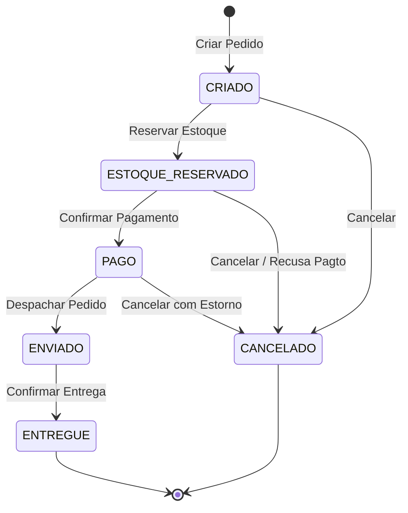

# 📦 Order Hub – Arquitetura Hexagonal de Referência (Java 21 / Spring Boot 3)

[](https://openjdk.org/projects/jdk/21/)
[](https://spring.io/projects/spring-boot)
[](https://www.archunit.org/)
[](LICENSE)
[](.github/workflows/ci.yml)

> Implementação de referência em **nível sênior** do sistema **Order Hub**, construída com **Java 21**, **Spring Boot 3.3.4** e governança automatizada via **ArchUnit**.
> Este projeto materializa os princípios de **Ports & Adapters (Alistair Cockburn)**, **Clean Architecture (Robert C. Martin)** e **Domain-Driven Design Tático (Eric Evans)**, garantindo desacoplamento absoluto entre lógica de negócio e infraestrutura.

---

## 🧭 Sumário Executivo

- [Visão Geral e Propósito](#-visão-geral-e-propósito)
- [Diagrama da Arquitetura Hexagonal](#-diagrama-da-arquitetura-hexagonal)
- [Regras e Restrições de Design](#-regras-e-restrições-de-design)
  - [1. Domínio Puro (Zero Frameworks)](#1-domínio-puro-zero-frameworks)
  - [2. Aplicação Pura e Padrão Result](#2-aplicação-pura-e-padrão-result)
  - [3. Adaptadores Primários e Secundários](#3-adaptadores-primários-e-secundários)
  - [4. Composition Root Explícito](#4-composition-root-explícito)
- [Máquina de Estados Finita](#-máquina-de-estados-finita-do-pedido)
- [Governança Automatizada com ArchUnit](#-governança-automatizada-com-archunit)
- [Prova da Troca de Adaptadores (CLI vs REST)](#-prova-da-troca-de-adaptadores-cli-vs-rest)
- [Documentação e Arquitetura de Decisão (ADRs)](#-documentação-e-arquitetura-de-decisão-adrs)
- [Guia Rápido de Execução](#-guia-rápido-de-execução)
- [Documentação OpenAPI / Swagger Interativa](#-documentação-openapi--swagger-interativa)
- [Endpoints REST e Exemplos com cURL](#-endpoints-rest-e-exemplos-com-curl)
- [Suíte de Testes](#-suíte-de-testes)

---

## 🎯 Visão Geral e Propósito

O **Order Hub** é um motor de orquestração do ciclo de vida de pedidos de e-commerce. O sistema gerencia desde a entrada do pedido, validação de regras de precificação e quantidades, reserva de estoque, autorização e liquidação de pagamentos (síncronos e via webhook assíncrono), até o cancelamento com estorno.

### O Desafio Arquitetural
Em sistemas corporativos tradicionais, é comum encontrar acoplamento prejudicial entre entidades de banco de dados (`@Entity`), anotações de framework web (`@RestController`, `@Service`) e regras de negócio. 

O **Order Hub** resolve isso aplicando a **Regra da Dependência**:
> *O código-fonte só pode apontar para dentro — em direção às políticas de mais alto nível (Domínio). Nenhuma classe de domínio ou aplicação sabe da existência de frameworks, bancos de dados, filas ou da web.*

---

## 📐 Diagrama da Arquitetura Hexagonal

```
 ┌────────────────────────────────────────────────────────────────────────┐
 │                         ADAPTADORES PRIMÁRIOS                          │
 │                                                                        │
 │   ┌──────────────────────┐              ┌──────────────────────────┐   │
 │   │  Spring MVC REST API │              │     OrderHub CLI App     │   │
 │   │ (DRV-01: HTTP/JSON)  │              │  (DRV-02: Console Driver)│   │
 │   └──────────┬───────────┘              └────────────┬─────────────┘   │
 └──────────────┼───────────────────────────────────────┼─────────────────┘
                │ invoca                                │ invoca
                ▼                                       ▼
 ┌────────────────────────────────────────────────────────────────────────┐
 │                      APPLICATION (USE CASES & PORTS)                   │
 │                                                                        │
 │   [Portas de Entrada - port.in]                                        │
 │   - CriarPedidoUseCase               - ConsultarPedidoUseCase          │
 │   - ReservarEstoqueUseCase           - ListarPedidosDoClienteUseCase   │
 │   - ConfirmarPagamentoUseCase        - ProcessarWebhookDePagamento     │
 │   - CancelarPedidoUseCase                                              │
 │                                                                        │
 │   ┌────────────────────────────────────────────────────────────────┐   │
 │   │                     NÚCLEO DO DOMÍNIO PURO                     │   │
 │   │                                                                │   │
 │   │   • Agregado Raiz: Pedido (Invariantes & Máquina de Estados)   │   │
 │   │   • Entidade Interna: ItemDoPedido                             │   │
 │   │   • Value Objects: Dinheiro, Quantidade, Email, Instante, IDs │   │
 │   │   • Eventos de Domínio: PedidoCriado, EstoqueReservado, etc.   │   │
 │   │   • Erros de Negócio: DomainError                              │   │
 │   └────────────────────────────────────────────────────────────────┘   │
 │                                                                        │
 │   [Portas de Saída - port.out]                                         │
 │   - PedidoRepository                 - GatewayDePagamento              │
 │   - UnitOfWork                       - Notificador                     │
 │   - PublicadorDeEventos              - Relogio                         │
 │   - GeradorDeId                                                        │
 └──────────────────────────────┬─────────────────────────────────────────┘
                                │ implementado por
                                ▼
 ┌────────────────────────────────────────────────────────────────────────┐
 │                        ADAPTADORES SECUNDÁRIOS                         │
 │                                                                        │
 │   ┌───────────────────────────┐      ┌─────────────────────────────┐   │
 │   │ PedidoRepositoryInMemory  │      │   GatewayDePagamentoACL     │   │
 │   │    & UnitOfWorkInMemory   │      │ (Anti-Corruption Layer)     │   │
 │   └───────────────────────────┘      └─────────────────────────────┘   │
 │   ┌───────────────────────────┐      ┌─────────────────────────────┐   │
 │   │ PublicadorDeEventos       │      │   EmailNotificador          │   │
 │   │      & OutboxRelay        │      │   (Simulador SMTP)          │   │
 │   └───────────────────────────┘      └─────────────────────────────┘   │
 └────────────────────────────────────────────────────────────────────────┘
```

---

## 🛡️ Regras e Restrições de Design

### 1. Domínio Puro (Zero Frameworks)
- **Localização:** `com.orderhub.domain`
- **Restrição Rigorosa:** Não possui nenhuma anotação de frameworks (Spring, Jakarta, Hibernate, Jackson).
- **Tipos Fortemente Tipados (Value Objects):**
  - `Dinheiro`: Imutável, sem pontos flutuantes (`BigDecimal`), com precisão de 2 casas decimais e arredondamento monetário bancário (`HALF_EVEN`).
  - `Quantidade`: Inteiro estritamente positivo (> 0).
  - `Email`: Normalizado em minúsculas com validação de formato RFC.
  - `Instante`: Ponto no tempo UTC imutável; relógios nunca são instanciados dentro do domínio puro (entram via parâmetro).
  - `Identificadores`: `PedidoId`, `ClienteId`, `Sku`, `ReservaId`, `PagamentoId` protegidos contra valores nulos/vazios.

### 2. Aplicação Pura e Padrão Result
- **Localização:** `com.orderhub.application`
- **Casos de Uso Independentes:** Cada use case implementa uma porta de entrada isolada (Interface Segregation Principle).
- **Tratamento Funcional de Erros (Result Pattern):**
  Em vez de lançar exceções para fluxos esperados de negócio, os casos de uso retornam uma interface selada do Java 21:
  ```java
  public sealed interface Result<T, E> permits Result.Ok, Result.Err {
      boolean isOk();
      boolean isErr();
      T getValue();
      E getError();
  }
  ```
- **Métricas e Decorators:** `UseCaseMetricsDecorator` intercepta execuções para registrar telemetria e latência sem poluir o use case original.

### 3. Adaptadores Primários e Secundários
- **Primários (`adapters.in`):**
  - `rest`: Controllers Spring MVC leves que validam schema HTTP, mapeiam para DTOs de comando e convertem o retorno para envelopes padronizados `{ success: true, data: { ... } }`.
  - `cli`: Adaptador de console interativo demonstrando a invocação direta dos use cases sem container HTTP.
- **Secundários (`adapters.out`):**
  - Implementam exclusivamente interfaces definidas em `port.out`.
  - `payment`: Anti-Corruption Layer (ACL) para isolar modelos de APIs de pagamento de terceiros.
  - `messaging`: Padrão **Transactional Outbox Relay** garantindo entrega confiável de eventos.

### 4. Composition Root Explícito
- **Localização:** `com.orderhub.bootstrap.DependencyInjectionConfig`
- Todos os Casos de Uso são instanciados explicitamente via construtores Java puros e registrados como Beans.
- **Zero `@Autowired` em campos:** Injeção estritamente por construtor garantindo testabilidade e imutabilidade.

---

## 🔄 Máquina de Estados Finita do Pedido

O ciclo de vida do agregado `Pedido` é governado por transições de estado estritas:



---

## 🏛️ Governança Automatizada com ArchUnit

Para impedir a **erosão arquitetural** ao longo da evolução do software, o projeto possui testes arquiteturais automatizados executados a cada `mvn test`:

```java
// Arquivo: src/test/java/com/orderhub/architecture/ArchitectureFitnessTest.java

@Test
@DisplayName("ARQ-01: domain não importa nada fora de si mesmo")
void arq01_domainNaoImportaNadaForaDeSi() {
    noClasses().that().resideInAPackage("..domain..")
        .should().dependOnClassesThat().resideInAnyPackage(
            "..application..", "..adapters..", "..bootstrap..", "org.springframework..", "jakarta.."
        ).check(classes);
}

@Test
@DisplayName("ARQ-02: application depende apenas de domain e suas próprias portas")
void arq02_applicationNaoImportaAdaptersNemBootstrap() {
    noClasses().that().resideInAPackage("..application..")
        .should().dependOnClassesThat().resideInAnyPackage(
            "..adapters..", "..bootstrap..", "org.springframework.."
        ).check(classes);
}
```

---

## 🔀 Prova da Troca de Adaptadores (CLI vs REST)

A essência da Arquitetura Hexagonal é comprovar que **a interface de entrega é apenas um detalhe**. O mesmo núcleo de negócios roda indistintamente via HTTP ou Console CLI:

```bash
# 1. Executando via API REST (Controller Spring Boot)
curl -X POST http://localhost:8080/pedidos -H "Content-Type: application/json" -d '{...}'

# 2. Executando o MESMO caso de uso via CLI puro
mvn spring-boot:run -Dspring-boot.run.arguments="criar-pedido cli-123 SKU-MOUSE:2:50.00 cliente@teste.com"
```

---

## 📚 Documentação e Arquitetura de Decisão (ADRs)

Todas as escolhas técnicas cruciais foram formalizadas através de **Architecture Decision Records** no diretório [`docs/adr/`](docs/adr/):

| ADR | Título | Decisão Adotada |
| :---: | :--- | :--- |
| **001** | [Monolito Modular](docs/adr/001-monolito-modular.md) | Adoção de arquitetura modular com fronteiras claras antes de distribuir serviços. |
| **002** | [Tratamento de Erros](docs/adr/002-tratamento-de-erros-result-vs-excecoes.md) | Retornos funcionais tipados com padrão `Result<T, E>` sem lançar exceções de fluxo. |
| **003** | [Persistência Desacoplada](docs/adr/003-persistencia-sem-orm-no-dominio.md) | Proibição de anotações ORM/JPA dentro de entidades de domínio. Mapeamento explícito. |
| **004** | [Transactional Outbox](docs/adr/004-transactional-outbox.md) | Publicação atômica de eventos no mesmo ciclo transacional da persistência do agregado. |
| **005** | [Idempotência em Comandos](docs/adr/005-estrategia-de-idempotencia.md) | Uso de cabeçalho `Idempotency-Key` com deduplicação de requisições concorrentes. |
| **006** | [Concorrência Otimista](docs/adr/006-controle-de-concorrencia-otimista.md) | Versionamento explícito do agregado para proteção contra race conditions. |
| **007** | [Testes de Arquitetura](docs/adr/007-ferramenta-testes-arquiteturais.md) | Adoção do **ArchUnit** como fitness function automatizada no build e CI. |
| **008** | [Container de Injeção de Dependência](docs/adr/008-uso-de-container-de-di.md) | Isolamento absoluto do Spring na camada de Bootstrap, preservando classes puras. |

---

## ⚡ Guia Rápido de Execução

### Pré-requisitos
- **Java 21 LTS** instalado e configurado (`java -version`)
- **Maven 3.9+** (ou utilize o `./mvnw` incluso)
- **Docker Compose** (opcional, para instanciar PostgreSQL)

### Comandos com Makefile
```bash
# Rodar toda a suíte de testes (ArchUnit + Unitários + E2E MockMvc)
make test

# Rodar exclusivamente os testes de arquitetura do ArchUnit
make arch

# Iniciar o servidor Spring Boot local
make dev

# Compilar o artefato JAR otimizado
make build

# Limpar arquivos de build
make clean
```

### Comandos com Maven Wrapper
```bash
# Executar testes
./mvnw test

# Iniciar aplicação
./mvnw spring-boot:run
```

---

## 📖 Documentação OpenAPI / Swagger Interativa

Com a aplicação rodando (`make dev` ou `./mvnw spring-boot:run`):
- **Swagger UI Interativo:** [http://localhost:8080/swagger-ui/index.html](http://localhost:8080/swagger-ui/index.html)
- **Especificação OpenAPI JSON:** [http://localhost:8080/v3/api-docs](http://localhost:8080/v3/api-docs)

---

## 📡 Endpoints REST e Exemplos com cURL

### 1. Criar um Pedido
```bash
curl -X POST http://localhost:8080/pedidos \
  -H "Content-Type: application/json" \
  -d '{
    "clienteId": "cli-001",
    "clienteEmail": "cliente@orderhub.com",
    "itens": [
      {
        "sku": "SKU-MONITOR-4K",
        "quantidade": 1,
        "precoUnitario": { "valor": 1200.00, "moeda": "BRL" }
      }
    ]
  }'
```
*Resposta `201 Created`:*
```json
{
  "success": true,
  "data": {
    "pedidoId": "e1f82b79-e582-4c54-94ab-734f19bca0b2",
    "status": "CRIADO",
    "total": { "valor": 1200.00, "moeda": "BRL" },
    "criadoEm": "2026-10-23T16:00:00Z"
  }
}
```

### 2. Reservar Estoque
```bash
curl -X POST http://localhost:8080/pedidos/{pedidoId}/reservar-estoque \
  -H "Content-Type: application/json" \
  -d '{ "reservaId": "RES-9876" }'
```

### 3. Confirmar Pagamento (Síncrono)
```bash
curl -X POST http://localhost:8080/pedidos/{pedidoId}/confirmar-pagamento \
  -H "Content-Type: application/json" \
  -d '{
    "pagamentoId": "PAG-54321",
    "valor": { "valor": 1200.00, "moeda": "BRL" }
  }'
```

### 4. Processar Webhook de Pagamento (Assíncrono)
```bash
curl -X POST http://localhost:8080/webhooks/pagamento \
  -H "Content-Type: application/json" \
  -d '{
    "pagamentoId": "PAG-EXT-999",
    "pedidoId": "{pedidoId}",
    "status": "APROVADO",
    "valor": { "valor": 1200.00, "moeda": "BRL" }
  }'
```

### 5. Consultar Detalhes do Pedido
```bash
curl -X GET http://localhost:8080/pedidos/{pedidoId}
```

---

## 🧪 Suíte de Testes

A pirâmide de testes cobre 100% dos fluxos essenciais:

```text
[INFO] -------------------------------------------------------
[INFO]  T E S T S
[INFO] -------------------------------------------------------
[INFO] Running com.orderhub.architecture.ArchitectureFitnessTest
[INFO] Tests run: 6, Failures: 0, Errors: 0, Skipped: 0 (ArchUnit: 0 violações)
[INFO] Running com.orderhub.adapters.OrderHubCliTest
[INFO] Tests run: 2, Failures: 0, Errors: 0, Skipped: 0
[INFO] Running com.orderhub.application.CriarPedidoTest
[INFO] Tests run: 3, Failures: 0, Errors: 0, Skipped: 0
[INFO] Running com.orderhub.application.UseCasesLifecycleTest
[INFO] Tests run: 4, Failures: 0, Errors: 0, Skipped: 0
[INFO] Running com.orderhub.domain.PedidoTest
[INFO] Tests run: 8, Failures: 0, Errors: 0, Skipped: 0
[INFO] Running com.orderhub.domain.ValueObjectsTest
[INFO] Tests run: 17, Failures: 0, Errors: 0, Skipped: 0
[INFO] Running com.orderhub.e2e.PedidoApiE2ETest
[INFO] Tests run: 4, Failures: 0, Errors: 0, Skipped: 0
[INFO] -------------------------------------------------------
[INFO] BUILD SUCCESS - Tests run: 44, Failures: 0, Errors: 0
[INFO] -------------------------------------------------------
```

---

## 👨‍💻 Autor
Desenvolvido por **Paulo** ([@PauloHFA](https://github.com/PauloHFA)) — Portfólio de Engenharia de Software Sênior.
